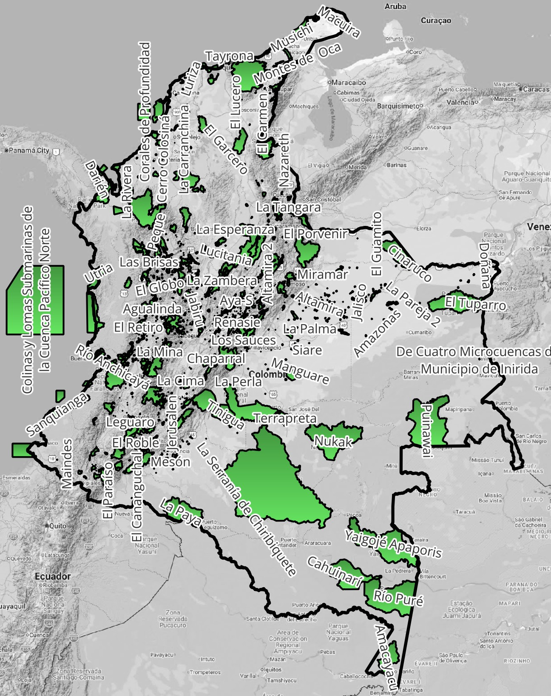

# Análisis de Parques Naturales Nacionales de Colombia - PNN

Reportes presentados por estudiantes del curso [TSIG y PYAS](https://github.com/rcfdtools/R.TSIG/blob/main/README.md).

| Parque Nacional                               | Categoría                                 | Reporte                                                                                                                                                                              |
|-----------------------------------------------|-------------------------------------------|--------------------------------------------------------------------------------------------------------------------------------------------------------------------------------------|
| Complejo Cenagoso de Zarate Malibú y Veladero | Distritos Regionales de Manejo Integrado  | [1000045114 & 1000098556](1000098556_1000045114_ComplejoCenagosoZarateMalibuVeladero.pdf), [1000091724 & 1000100425](1000091724_1000100425_ComplejoCenagosoZarateMalibuVeladero.pdf) |
| Complejo Cenagóso del Bajo Sinú               | Distritos Regionales de Manejo Integrado  | [1000105796](1000105796_ComplejoCenagosoBajoSinu.pdf), [1000091724 & 1000100425](1000091724_1000100425_ComplejoCenagosoZarateMalibuVeladero.pdf)                                     |
| Cueva de los Guacharos                        | Parque Nacional Natural                   | [1000103872](1000103872_CuevaLosGuacharos.pdf)                                                                                                                                       |
| El Corchal El Mono Hernández                  | Santuario de Fauna y Flora                | [1000110810](1000110810_ElCorchal.pdf), [1000106970](1000106970_ElCorchal.pdf)                                                                                                       |
| Galeras                                       | Santuario de Fauna y Flora                | [1000053954](1000053954_Galeras.pdf)                                                                                                                                                 |
| Guanentá Alto Río Fonce                       | Santuario de Fauna y Flora                | [1000111337](1000111337_GuanentaAltoRíoFonce.pdf), [1000106927](1000106927_GuanentaAltoRíoFonce.pdf), [1000115747](1000115747_GuanentaAltoRíoFonce.pdf)                              |
| Iguaque                                       | Santuario de Fauna y Flora                | [1000106431](1000106431_Iguaque.pdf), [1000098341](1000098341_Iguaque.pdf)                                                                                                           |
| Las Orquídeas                                 | Parque Nacional Natural                   | [1000045159](1000045159_LasOrquideas.pdf)                                                                                                                                            |
| Los Flamencos                                 | Santuario de Fauna y Flora                | [1000003213](1000003213_LosFlamencos.pdf), [1000100713](1000100713_LosFlamencos.pdf), [1000105543](1000105543_LosFlamencos.pdf)                                                      |
| Macuira                                       | Parque Nacional Natural                   | [1000102818](1000102818_Macuira.pdf), [1000104768](1000104768_Macuira.pdf)                                                                                                           |
| Plantas Medicinales Orito - Ingi Ande         | Santuario de Flora                        | [1000046376](1000046376_PlantasMedicinalesOrito.pdf), [1000046376]([1000106816](1000106816_PlantasMedicinalesOrito.pdf))                                                             |
| Selva de Florencia                            | Parque Nacional Natural                   | [1000106805](1000106805_SelvaDeFlorencia.pdf),[1000101025](1000101025_SelvaDeFlorencia.pdf)                                                                                          |

